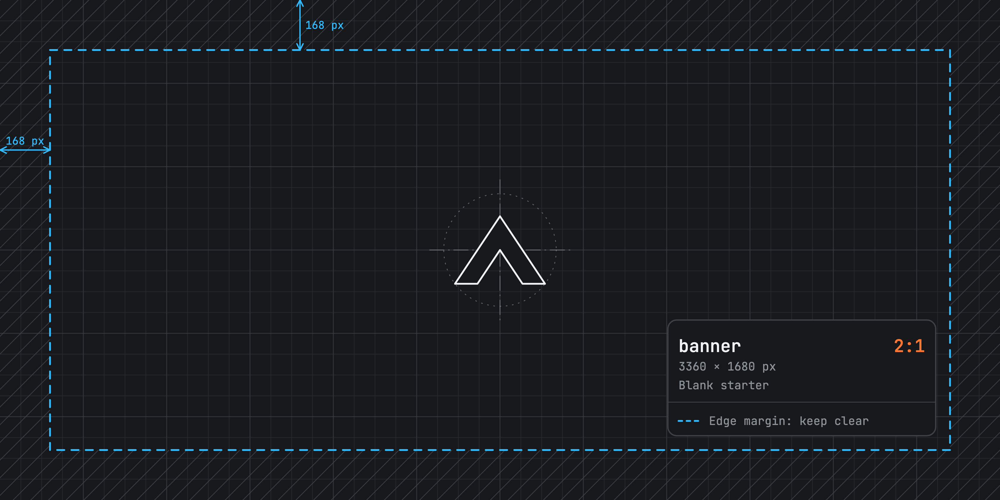

# Untitled Game



## A memorable tagline.

A brief, plain-text pitch for your game, in a sentence or two. It's shown when your game is featured, and in About when there's no description below.

---

Tell players about your game here. This section becomes your game's description. It appears in the **About** section on the store page. Expand on your game, highlight its features, embed **PNG images** and **MP4 videos** from the .arcadible/gallery directory, and format your description with [Arcadible Markdown](https://developer.arcadible.com/references/arcadible-markdown).

---

Everything after the last horizontal rule is ignored by Arcadible. Use this section for development notes, build instructions, or other repository documentation.

For larger projects, you can instead create an `arcadible.md` file to keep your store page content separate from your repository's `README.md`.

## Develop

There's no build step: `.arcadible-public/` is the game. `arc serve` runs it as Arcadible does, with its saves, and reloads it as you edit.

```sh
arc serve       # a local play page, at http://localhost:4100/
arc deploy      # publishes
```

The version starts as a prerelease, `0.1.0-beta.1`, so `arc deploy` publishes to staging: a link to play and share. Release `0.1.0` when you're ready to give the game its store page.

### References

- [Arcadible Manifest](https://developer.arcadible.com/references/arcadible-manifest)
  - [game.title](https://developer.arcadible.com/references/arcadible-manifest#game.title)
  - [game.tagline](https://developer.arcadible.com/references/arcadible-manifest#game.tagline)
  - [game.bio](https://developer.arcadible.com/references/arcadible-manifest#game.bio)
  - [game.description](https://developer.arcadible.com/references/arcadible-manifest#game.description)
  - [game.gallery](https://developer.arcadible.com/references/arcadible-manifest#game.gallery)
